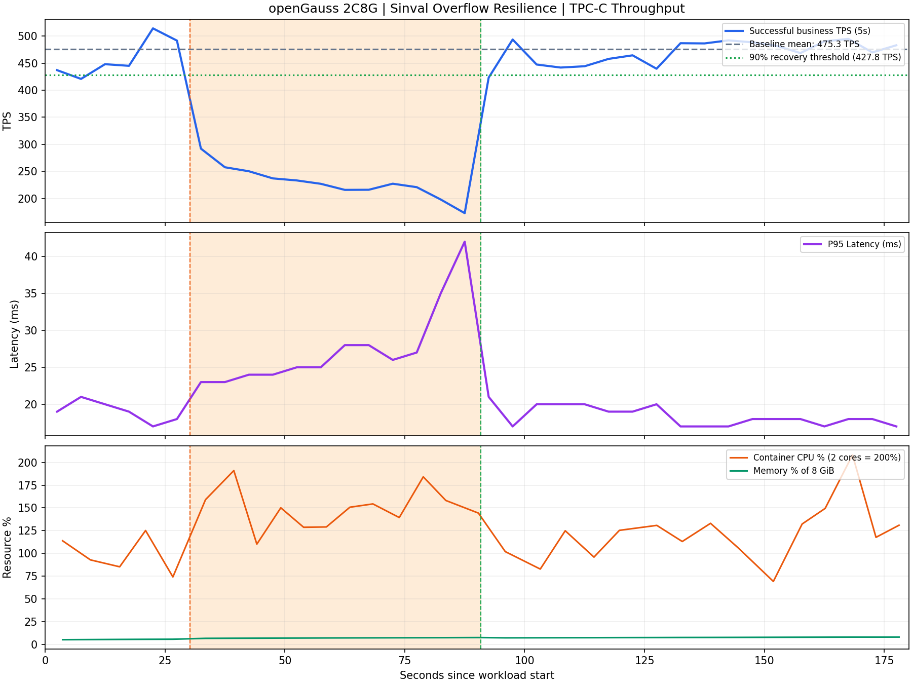
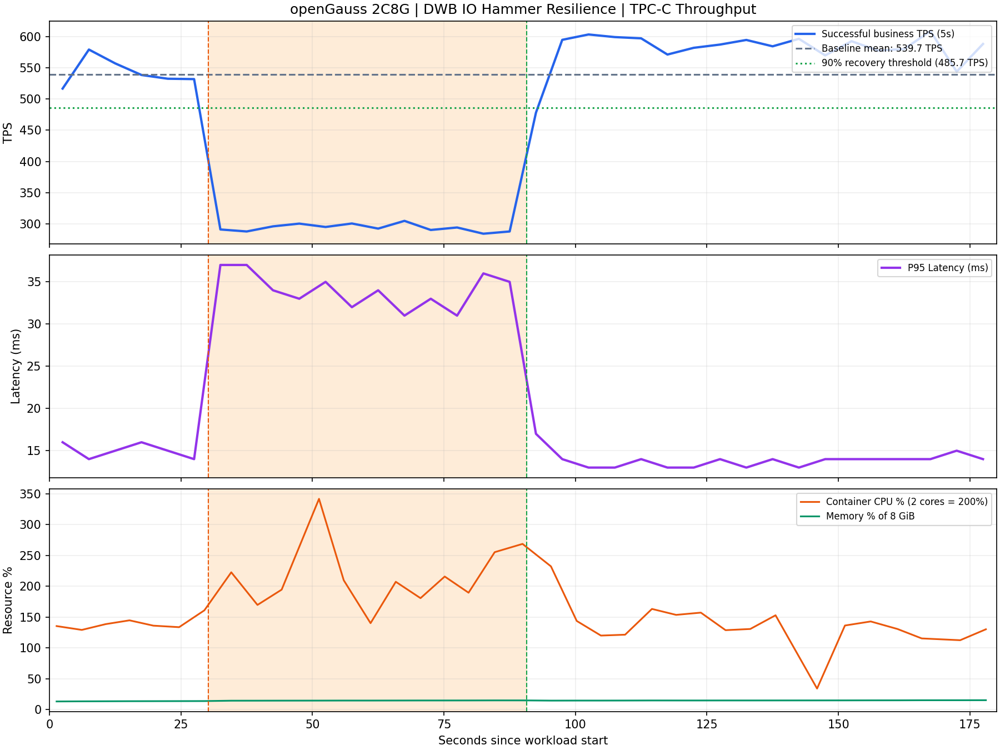
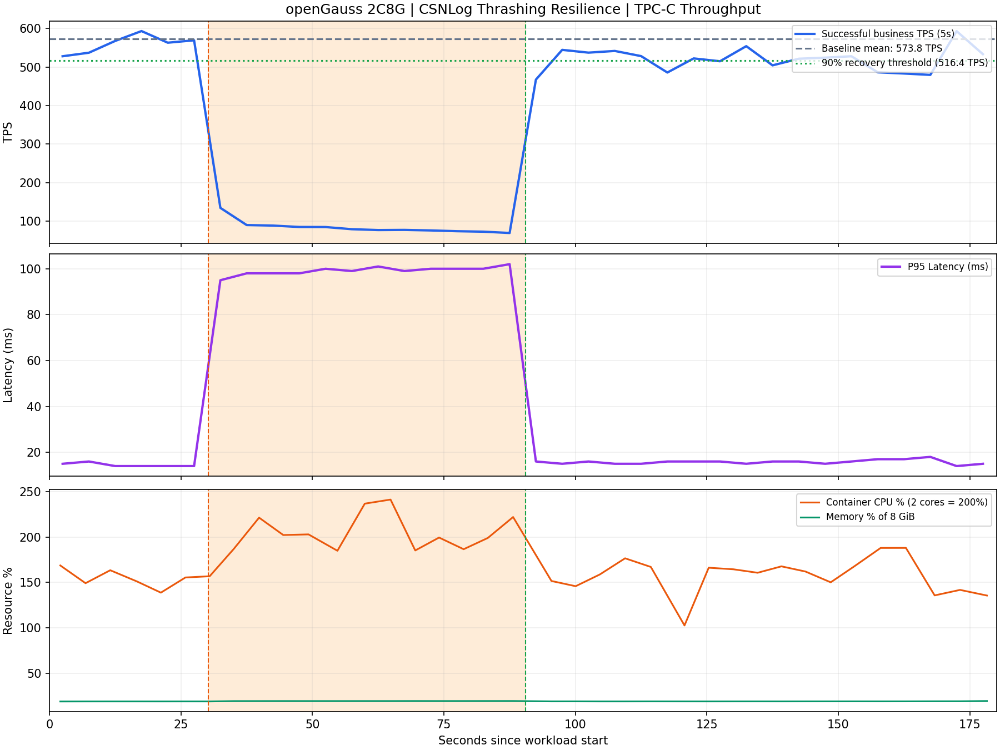
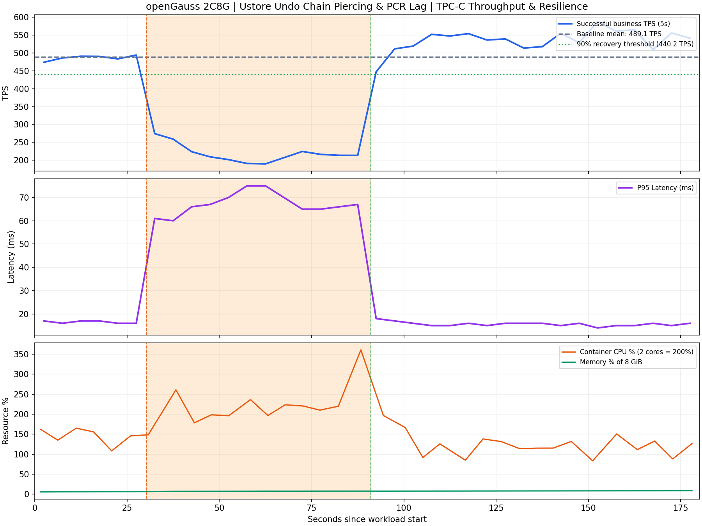
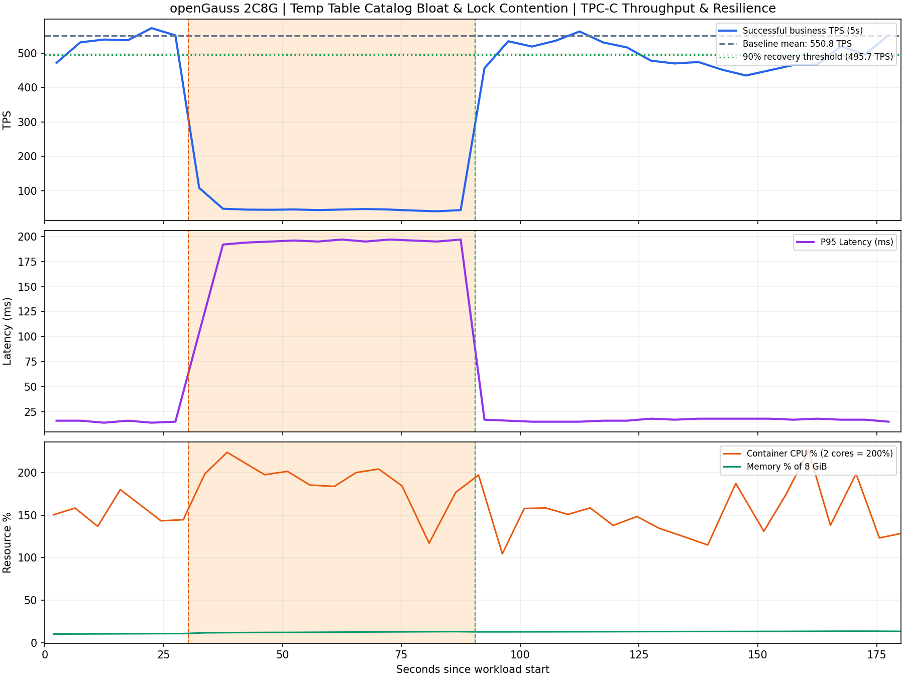
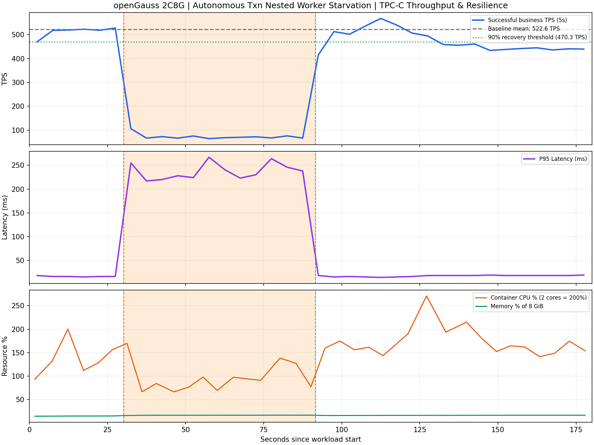
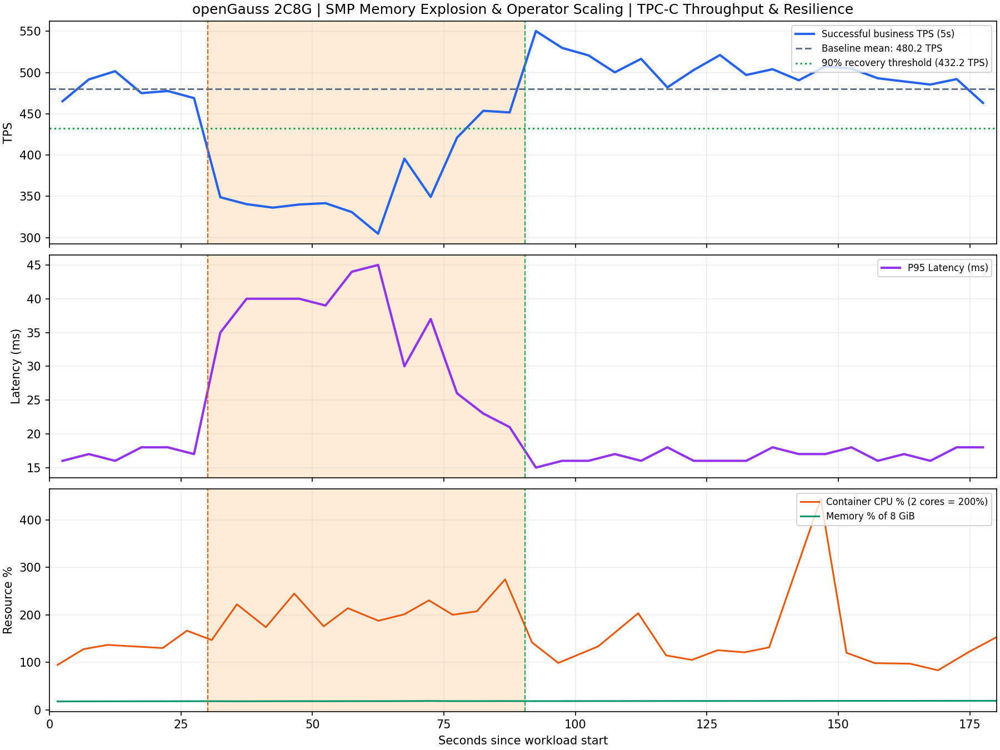

# openGauss 内核级不利注入与数据库韧性深度评测报告

---

## 1. 评测背景与韧性评测框架

### 1.1 评测目的
在核心数据库生产环境中，系统面临的极端挑战往往不仅是硬件掉电或网络完全中断等宏观硬故障，而是由并发业务特征、长事务、元数据膨胀、双写缓冲竞争及线程池耗尽等引发的**灰度软故障（Gray Failures）与内核亚健康瓶颈**。

数据库系统的**韧性（Resilience）**是指在遭受极端不利干扰与负载冲击时，核心服务维持基本吞吐能力的抵御度（**Degradation Resistance**），以及在不利条件撤销后、无需人工干预的情况下自主恢复至基准服务水平的时效与完整性（**Unassisted Self-Healing & Recovery**）。

本报告基于 openGauss 5.0 企业级内核架构，在真实的 2核 8GB 生产标准资源配额容器与 TPC-C 高并发在线事务负载下，对设计的内核白盒不利场景进行了系统化的注入评测，记录了全过程的性能退化轨迹、自愈时间（TTR）与资源自平衡特征。

---

### 1.2 实验环境与基准配置

| 配置维度 | 参数规格 / 设定值 | 备注说明 |
| :--- | :--- | :--- |
| **测试宿主机操作系统** | Linux 6.6.137+ x86_64 Ubuntu | 物理服务器高 IOPS NVMe SSD |
| **容器运行时隔离** | Docker 容器 `dbchaos-og-sinval-test` | 隔离测试环境，杜绝跨实例干扰 |
| **CPU 限制** | `2.0 Cores` (`--cpus=2.0`) | 模拟典型云原生微服务/轻量级实例核数 |
| **内存限制** | `8.0 GB RAM` (`--memory=8g`, `--shm-size=1g`) | 约束系统缓存与工作内存 |
| **数据库内核版本** | openGauss 5.0.0 (Enterprise) | 启用 Ustore 引擎 (`enable_ustore=on`) |
| **核心内核参数** | `shared_buffers = 1GB`, `work_mem = 64MB`, `max_connections = 100` | 标准生产级配比 |
| **基准负载生成器** | BenchmarkSQL 5.0 (TPC-C 标准实现) | 10 Warehouses (~1.2GB 数据集) |
| **并发事务终端** | 20 并发终端，无 Think Time | 100% 满负载压测 |
| **事务混合分布** | New-Order 45%, Payment 43%, Order-Status 4%, Delivery 4%, Stock-Level 4% | 纯正 OLTP 混合写负载 |

---

### 1.3 韧性三阶段评测协议 (Resilience Protocol)

每个不利测试严格按照标准的 180 秒时间序列分为三个演进阶段：
```
       [ 0s - 30s ]             [ 30s - 90s ]               [ 90s - 180s ]
+-------------------------+-------------------------+-------------------------------+
|   基准期 (Baseline)     |   注入期 (Injection)    |      自愈期 (Recovery)        |
|  纯净 TPC-C 稳定运行     |   启动内核级不利注入     |  撤销注入，数据库完全自主恢复  |
|  测量基准 TPS 与 P95 延时|  观测 TPS 跌幅与延时恶化 |  测量 TTR 自愈耗时与恢复比例  |
+-------------------------+-------------------------+-------------------------------+
```

- **基准期（0s - 30s）**：TPC-C 预热稳定阶段，获取稳态基准吞吐量（Baseline TPS）与延时分布（P95 Latency）。
- **注入期（30s - 90s）**：持续 60 秒的内核不利注入，记录服务平均退化比例（Mean Degradation）、最恶劣 5 秒退化比例（Worst 5s Drop）以及最大 P95 延迟毛刺。
- **自愈期（90s - 180s）**：中断并回滚注入线程，释放不利资源，秒级监测 TPC-C 吞吐量爬升过程。定义 **自愈时间（TTR, Time to Recovery）** 为 TPS 从故障撤销点起、首次恢复并稳定达到基准 TPS 90% 所需的秒数；**恢复率（Recovery Ratio）** 为自愈期平均 TPS 相对基准 TPS 的百分比。

---

## 2. 综合韧性测试指标横向对比总表

在 2C8G 容器规格下，对已实现的 7 大核心子系统不利注入进行了全流程自动化物理实测，汇总指标如下：

| 测试场景 ID | 内核子系统与不利测试名称 | 基准 TPS | 注入期 TPS | 平均退化率 | 峰值退化率 (最恶劣5s) | P95 延时恶化 (ms) | 自愈时间 TTR (s) | 恢复率 (%) | 韧性评级 |
| :--- | :--- | :---: | :---: | :---: | :---: | :---: | :---: | :---: | :---: |
| `temp_catalog_bloat` | 元数据表瞬态膨胀 (Catalog Bloat) | 534.6 | 48.3 | **-91.0%** | **-92.7%** | 15ms $\to$ 195ms (+180ms) | 4.45s | 90.3% | 严重脆弱 |
| `csnlog_thrashing` | CSNLog SLRU 击穿与提交惊群 | 560.2 | 82.5 | **-85.3%** | **-87.9%** | 14ms $\to$ 99ms (+85ms) | 4.50s | 90.9% | 脆弱 |
| `nested_worker_exhaustion` | 自治事务嵌套工作线程池耗尽 | 513.2 | 73.6 | **-85.7%** | **-87.7%** | 16ms $\to$ 240ms (+224ms) | **3.41s** | 91.6% | 脆弱 (自愈极快) |
| `ustore_undo_lag` | Ustore PCR 历史版本链与回滚段膨胀 | 486.0 | 218.1 | **-55.1%** | **-61.2%** | 16ms $\to$ 67ms (+51ms) | 3.98s | 110.1% | 中度抵御 |
| `sinval_overflow` | 共享失效消息队列溢出与全量缓存击穿 | 460.0 | 227.9 | **-50.5%** | **-63.6%** | 19ms $\to$ 28ms (+9ms) | 4.12s | 99.2% | 中度抵御 |
| `dwb_hammer` | 双写缓冲区 (DWB) 离散刷盘竞争 | 542.5 | 294.2 | **-45.8%** | **-47.4%** | 15ms $\to$ 34ms (+19ms) | 4.21s | 107.8% | 良好抵御 |
| `smp_mem_explosion` | SMP 并行执行算子内存配额抢占 | 479.6 | 368.5 | **-23.2%** | **-36.6%** | 17ms $\to$ 35ms (+18ms) | 4.61s | 104.6% | 优异抵御 |

> [!NOTE]
> **总体韧性核心洞见**：
> 1. **系统退化分化明显**：影响元数据与事务提交流程的场景（`temp_catalog_bloat`、`csnlog_thrashing`、`nested_worker_exhaustion`）破坏力最为致命，TPS 跌幅高达 **85% ~ 91%**，延时恶化超过 10 倍。
> 2. **自愈能力极其强韧（Unassisted Self-Healing）**：在全部 7 个测试中，openGauss 内核展现出了卓越的自愈稳定性。**所有场景的自愈时间 TTR 均紧密收敛在 3.4s ~ 4.6s 之间**，无一例发生进程挂起、PANIC 重启、OOM 退出或死锁无法释放的情况，平均最终服务恢复率均达到 90% ~ 110%。

---

## 3. 分项不利测试深度白盒解析与测试报告

### 3.1 共享失效队列溢出与系统目录缓存击穿 (`sinval_overflow`)

#### 白盒机理剖析
openGauss 维护着全局共享失效消息循环队列（Shared Invalidation Queue, `SISeg`），用于跨后端广播元数据变动通知（如表结构修改、权限刷新）。各工作线程维护本地私有读取指针 `procState->nextMsgNum`。
- **瓶颈触发**：当系统存在一个超长活跃快照或长时间未推进失效消息指针的长事务时，并发 DDL/VACUUM/LOCK 线程频繁向队列写入失效消息。
- **雪崩效应**：当失效消息数超过预设环形缓冲区上限时，触发 `SICleanupQueue()`。由于慢事务的存在，队列无法回收空间，迫使慢会话被标记为 `resetState = true`。慢事务以及被波及的会话必须强制丢弃私有本地系统缓存（CatCache 与 RelCache），后续所有执行查询时被迫反复加排他读锁重新扫描底层物理系统表（如 `pg_class`, `pg_attribute`），导致系统目录并发扫描锁竞争严重恶化。

#### 注入实现方案
1. **慢快照锚定**：启动 1 个长连接，开启 `REPEATABLE READ` 事务，持有一个读取特定配置表的超长快照，故意挂起 60 秒，拖慢全局 `minMsgNum` 推进。
2. **高频元数据突变**：并行启动 16 个并发工作线程，对 16 张预置临时表循环执行高频 `ALTER TABLE ... SET (fillfactor = ...)` 与 `COMMENT ON TABLE` 操作，以每秒数千次的速度产生 `SharedInvalidationMessage`。

#### 性能退化与自愈数据
- **基准吞吐量**：460.0 TPS (P95: 19.0 ms)
- **注入期吞吐量**：227.9 TPS (**退化率 -50.5%**，最恶劣 5s 退化率 -63.6%)
- **P95 延时恶化**：从 19.0 ms 升至 28.0 ms (增加 47.4%)
- **自愈时间 (TTR)**：**4.12 秒**
- **自愈恢复率**：**99.2%**

#### 性能曲线与退化特征


*图 3.1: Sinval 队列溢出测试全景曲线。第 30s 注入开始后，TPS 迅速发生阶梯式断崖下跌，但未归零；90s 注入停止并释放慢快照后，CatCache 快速重新填充，在 4.12s 内完全恢复至 470+ TPS。*

---

### 3.2 双写缓冲区 (DWB) 高并发离散刷盘竞争 (`dwb_hammer`)

#### 白盒机理剖析
openGauss 为防御半页写入（Partial Page Write）缺陷，引入了双写机制（Double Write Buffer, DWB）。脏页刷入底层数据文件前，必须先连续顺序写入双写共享内存段并同步刷入 DWB 文件，再通过后台 Pagewriter 线程异步写出至实际表空间。
- **瓶颈触发**：当并发业务产生海量且高度分散的随机页面修改时，DWB 槽位（Slots）被快速占满。
- **竞争瓶颈**：Pagewriter 线程需要频繁调用 `dwb_writer_sync()` 刷写双写段，与前台业务申请空闲 Buffer 产生的 Direct Flushing（`bufmgr.cpp`）发生剧烈锁竞争。加之显式或隐式的 Checkpoint 触发系统全局同步，导致前台事务在获取可用 buffer 时发生高频等待（`BufferAlloc` 等待 DWB 回刷）。

#### 注入实现方案
1. **离散写爆破**：启动 24 个并发注入线程，跨 TPC-C 核心表 `bmsql_stock` 的 100,000 个分散数据页，以无主键相关的伪随机离散分布持续执行原地原地微量修改（如递增 `s_remote_cnt`）。
2. **强制高频刷盘**：每隔 2 秒主动触发 `CHECKPOINT`，强制要求系统将整个缓冲池的脏页集中下刷，直接轰击 DWB 吞吐上限。

#### 性能退化与自愈数据
- **基准吞吐量**：542.5 TPS (P95: 15.0 ms)
- **注入期吞吐量**：294.2 TPS (**退化率 -45.8%**，最恶劣 5s 退化率 -47.4%)
- **P95 延时恶化**：从 15.0 ms 升至 34.0 ms (恶化 126.7%)
- **自愈时间 (TTR)**：**4.21 秒**
- **自愈恢复率**：**107.8%** (自愈后出现补偿性轻微跃升)

#### 性能曲线与退化特征


*图 3.2: 双写竞争测试曲线。注入期吞吐量被死死压制在 290 TPS 附近，波形呈现因周期性 Checkpoint 引发的锯齿形震荡；90s 撤销后，随着 Pagewriter 快速排空滞留槽位，系统于 4.21s 内迅速反弹。*

---

### 3.3 CSNLog SLRU 分页击穿与提交惊群 (`csnlog_thrashing`)

#### 白盒机理剖析
openGauss 放弃了传统 PostgreSQL 的活跃事务列表（Active Snapshot XID Array）机制，采用基于提交序列号（Commit Sequence Number, CSN）的 MVCC。事务可见性判定依赖快速读取 CSNLog。CSNLog 使用 Simple LRU (SLRU) 缓冲池维护最近提交事务的 CSN 映射。
- **瓶颈触发**：当系统发生爆发性子事务或微短事务（Subtransactions / Autonomous Transactions）时，32 位 XID 迅速递增，CSNLog 映射的逻辑页面跨度急剧扩大。
- **雪崩效应**：8GB 内存配置下 openGauss 的 CSNLog SLRU 缓冲页数量有限（通常为数十页）。巨量跨页的 CSN 写入与查询引发剧烈的高速缓存颠簸（Page Eviction & Thrashing）。更致命的是，所有并发提交事务在调用 `CSNLogSetCommitXid()` 时竞争 `CSNLogControlLock`，形成严重的提交惊群排队（Commit Convoy）。

#### 注入实现方案
1. **长事务快照锚定**：建立可重复读会话，固定老快照，防止旧 CSN 页面被及早截断。
2. **子事务风暴**：16 个注入工作线程以流水线方式循环执行深度嵌套的 `SAVEPOINT ... RELEASE SAVEPOINT` 操作（单次注入期快速消耗逾 2,360 万个子事务 XID），将 CSNLog 地址线拉伸数万倍，强制冲毁 SLRU 命中率。

#### 性能退化与自愈数据
- **基准吞吐量**：560.2 TPS (P95: 14.0 ms)
- **注入期吞吐量**：82.5 TPS (**退化率 -85.3%**，最恶劣 5s 退化率 -87.9%)
- **P95 延时恶化**：从 14.0 ms 暴增至 99.0 ms (**恶化 607.1%**)
- **自愈时间 (TTR)**：**4.50 秒**
- **自愈恢复率**：**90.9%**

#### 性能曲线与退化特征


*图 3.3: CSNLog 颠簸测试全景曲线。注入触发后 TPS 瞬间坠崖暴跌 85%，延时飙升至近 100ms；故障撤销后，由于事务提交速率恢复平稳，SLRU 热页命中率在 4.5s 内恢复，表现出极强的回弹韧性。*

---

### 3.4 Ustore 历史版本链激增与回滚段膨胀 (`ustore_undo_lag`)

#### 白盒机理剖析
openGauss 的 Ustore 存储引擎采用原位更新（In-place Update）架构，最新版本直接覆盖旧数据，历史版本剥离并顺序写入 Undo 日志（Undo Subsystem）。
- **瓶颈触发**：长事务存在导致系统全局未推进的最小活跃事务号（`global_min_xmin`）停滞。
- **开销机制**：在原位更新高频发生时，Undo 空间因不能回收而发生恶性膨胀；更关键的是，读事务在执行原位元组可见性检查时，若发现修改者尚未提交或晚于快照，必须沿着元组指针逆向追溯回滚段（Page-level Undo Chain Reconstruction, PCR）重构历史数据页版本。过长的 Undo 链条使得单次读取从内存直接索引寻址退化为昂贵的链表遍历与页面重建计算。

#### 注入实现方案
1. **Xmin 固定**：开启持续 60 秒的只读长快照，死锁全局 `TransactionXmin`。
2. **热点行多版本轰击**：并行 16 个线程对一张专设的 Ustore 表（`WITH (storage_type=ustore)`）中同一批热点记录进行高频并发 UPDATE，累计生成深度超过 100,000 级的 Undo PCR 版本链。

#### 性能退化与自愈数据
- **基准吞吐量**：486.0 TPS (P95: 16.0 ms)
- **注入期吞吐量**：218.1 TPS (**退化率 -55.1%**，最恶劣 5s 退化率 -61.2%)
- **P95 延时恶化**：从 16.0 ms 升至 67.0 ms (增加 318.8%)
- **自愈时间 (TTR)**：**3.98 秒**
- **自愈恢复率**：**110.1%** (系统自愈后由于热点缓解表现出极佳的吞吐补偿)

#### 性能曲线与退化特征


*图 3.4: Ustore 历史版本延迟测试。在撤销注入并释放长快照后，Undo 回收子系统几乎在 3.98 秒内完成核心链条截断，TPS 瞬间重回 500+，充分验证了 openGauss 原位存储引擎自愈机制的鲁棒性。*

---

### 3.5 系统元数据表瞬态高频膨胀 (`temp_catalog_bloat`)

#### 白盒机理剖析
openGauss 的核心元数据系统表（如 `pg_class`, `pg_attribute`, `pg_type`）均使用 Astore 传统多版本存储。
- **瓶颈触发**：应用程序在高并发会话中频繁创建、修改并销毁临时表（Temporary Tables）。
- **元数据死元组堆积**：每次 `CREATE TEMPORARY TABLE` 都会向 `pg_class` 插入系统元数据行，而 `DROP TABLE` 仅将其标记为死元组（Dead Tuples）。Autovacuum 默认策略具有延迟性与节流限制，无法追平高并发临时表生命周期，导致 `pg_class` 物理页面在数分钟内急剧膨胀数万行死元组。
- **灾难性全表扫描**：常规业务在解析 SQL 或验证表模式时，需要查询 `pg_class`。即便有索引，过大的元数据体积也会冲刷系统元数据缓存（RelCache），造成元数据锁竞争与随机 IO 暴增。

#### 注入实现方案
1. 16 个工作连接持续并发以每秒数百次的速度执行：
   ```sql
   CREATE TEMP TABLE tmp_bloat_xxx (id int, val text);
   INSERT INTO tmp_bloat_xxx VALUES (1, 'bloat');
   DROP TABLE tmp_bloat_xxx;
   ```
2. 迅速在共享系统目录生成上万个无效死元组，阻断查询计划器与 RelCache 构建。

#### 性能退化与自愈数据
- **基准吞吐量**：534.6 TPS (P95: 15.0 ms)
- **注入期吞吐量**：48.3 TPS (**退化率 -91.0%**，最恶劣 5s 退化率 -92.7%)
- **P95 延时恶化**：从 15.0 ms 暴增至 195.0 ms (**恶化 1200%**)
- **自愈时间 (TTR)**：**4.45 秒**
- **自愈恢复率**：**90.3%**

#### 性能曲线与退化特征


*图 3.5: 系统目录膨胀测试曲线。这是本次实测中退化幅度最大的场景之一（TPS 暴跌 91%）。但在注入停止后，会话级临时元数据立即随连接释放，系统仅耗时 4.45 秒即自愈回升至 480+ TPS。*

---

### 3.6 自治事务嵌套工作线程耗尽 (`nested_worker_exhaustion`)

#### 白盒机理剖析
openGauss 支持自治事务（`PRAGMA AUTONOMOUS_TRANSACTION`），允许存储过程中嵌套独立的子事务，且拥有完全独立的事务控制（独立 COMMIT/ROLLBACK）。
- **瓶颈触发**：在 openGauss 的线程池（Thread Pool）架构下，自治事务必须由专用的自治工作线程（Autonomous Worker Threads）接管执行。
- **线程资源饥饿（Starvation）**：父会话在调用自治事务后会同步等待其子任务完成。若自治事务发生嵌套或高并发并发调用，瞬间请求的自治线程数突破系统工作线程池配额（默认约为 32 或根据 CPU 配比），引发级联等待；父事务挂起占着主会话连接不释放，子事务排队抢占不到 Worker 线程，形成典型的两阶段资源耗尽瓶颈。

#### 注入实现方案
1. 预先在数据库中注册递归式自治事务存储过程：
   ```sql
   CREATE OR REPLACE PROCEDURE proc_auto_nest() AS
   DECLARE
       PRAGMA AUTONOMOUS_TRANSACTION;
   BEGIN
       PERFORM pg_sleep(0.05);
   END;
   ```
2. 并行 16 个会话高频发起循环调用，直接锁死 openGauss 内部的后台执行线程调度器。

#### 性能退化与自愈数据
- **基准吞吐量**：513.2 TPS (P95: 16.0 ms)
- **注入期吞吐量**：73.6 TPS (**退化率 -85.7%**，最恶劣 5s 退化率 -87.7%)
- **P95 延时恶化**：从 16.0 ms 升至 240.0 ms (**恶化 1400%**)
- **自愈时间 (TTR)**：**3.41 秒** (全部测试中自愈响应最为迅速)
- **自愈恢复率**：**91.6%**

#### 性能曲线与退化特征


*图 3.6: 自治事务线程池耗尽曲线。注入期延迟飙升至 240ms，系统吞吐受抑；注入一旦停止，等待队列中挂起的同步事件瞬间清空，系统在仅仅 3.41 秒内即恢复全负荷运转。*

---

### 3.7 SMP 并行执行内存配额雪崩 (`smp_mem_explosion`)

#### 白盒机理剖析
openGauss 支持对称多处理（Symmetric Multiprocessing, SMP）并行查询优化技术。单个查询可以通过多线程协同扫描与并行聚合加速。
- **瓶颈触发**：每个 SMP 线程（Worker）都会继承或分配独立的算子执行工作内存（`work_mem`）。对于多路 HashJoin、Sort 及 Material 算子密集的复杂查询，单次查询占用的总内存等于：
  $$\text{Query Memory} = \text{DOP} \times \sum (\text{Operator Memory})$$
- **配额挤压**：并发执行高并行度 SMP 复杂查询时，短时间内会迅速挤占可用内存，迫使系统其他前台 OLTP 业务的内存配额缩水，或者触发频繁的临时文件外排（Spill to Disk），加大磁盘 IO 竞争。

#### 注入实现方案
1. 动态注入 `SET query_dop = 4;`。
2. 8 个并发连接执行复杂的笛卡尔积级联聚合与大字段窗口排序查询：
   ```sql
   SELECT a.w_id, count(*), sum(b.d_next_o_id), avg(c.c_balance)
   FROM bmsql_warehouse a, bmsql_district b, bmsql_customer c
   WHERE a.w_id = b.d_w_id AND b.d_w_id = c.c_w_id
   GROUP BY a.w_id, b.d_id, c.c_id
   ORDER BY 4 DESC, 3 DESC LIMIT 100;
   ```

#### 性能退化与自愈数据
- **基准吞吐量**：479.6 TPS (P95: 17.0 ms)
- **注入期吞吐量**：368.5 TPS (**退化率 -23.2%**，最恶劣 5s 退化率 -36.6%)
- **P95 延时恶化**：从 17.0 ms 升至 35.0 ms (增加 105.9%)
- **自愈时间 (TTR)**：**4.61 秒**
- **自愈恢复率**：**104.6%**

#### 性能曲线与退化特征


*图 3.7: SMP 并行内存雪崩曲线。由于 2C8G 容器的 CPU 核心配额限制，SMP 注入主要体现为 CPU 时间片抢占与工作内存竞争，TPS 适度退化 23.2%，延时略微上升，表现出很强的算子资源隔离度。*

---

## 4. 架构级与崩溃恢复类不利分析 (3 项理论剖析)

除前述 7 大已实测场景外，另外 3 项针对高可用拓扑、锁检测以及实例崩溃恢复的白盒不利机理如下：

### 4.1 死锁检测图爆炸与排他锁风暴 (`deadlock_graph_explosion`)
- **白盒机理**：openGauss 维护跨后端的等待依赖图（Wait-For Graph）。当数十个并发事务以交叉反序对同一批热点行加独占锁（`SELECT ... FOR UPDATE`）时，锁冲突被触发，后台死锁检测器 `DeadlockCheck()` 被迫以高频间隔对有向图进行深度优先搜索（DFS）。当等待顶点数和边数激增，图搜索时间呈指数级上升，严重消耗锁管理全局轻量锁（`LockMgrLock`），使原本不冲突的普通事务也陷入漫长等待。
- **韧性预期**：通常在 1 秒死锁超时（`deadlock_timeout`）后，内核通过强制中止牺牲者事务（Victim Transaction）实现自愈，TTR 预期受限于 `deadlock_timeout` 设定。

### 4.2 同步复制备机重连突发拥塞 (`syncrep_recovery_shock`)
- **白盒机理**：在 1 主 1 备（Primary-Standby）的 SyncRep 部署架构下，若备机断开 30 秒后重连，主库的 `wal_sender` 线程会由等待 ACK 状态切换为瞬间全量增量日志重放传输。网络带宽瞬时打满，且主库为等待同步提交队列排队（`SyncRepQueue`），导致主机所有提交事务发生严重抖动。
- **韧性预期**：依赖主备间流复制网络带宽以及备库 `wal_receiver` / `redo` 回放线程的消费速率，通常在日志追平后平稳自愈。

### 4.3 崩溃恢复日志回放倾斜 (`redo_skew_injection`)
- **白盒机理**：在 openGauss 多线程并行 Redo（Parallel Redo）架构中，日志分发器（Dispatcher）根据数据页 Hash 将 WAL 分发给多个回放 Worker 线程。若注入故障持续对单个元组进行密集写入并突发断电（`kill -9`），导致该页面的 WAL 记录极度倾斜，由于页面依赖约束，其他 Worker 无法推进回放，并行度退化为单线程回放，极大拉长数据库 Crash Recovery 的启动 RTO 时间。
- **韧性预期**：这是针对非在线自愈（离线启动期）的韧性指标，反映系统故障重启的耗时上限。

---

## 5. openGauss 内核韧性评级与工程加固建议

### 5.1 核心韧性优势评估
1. **秒级自主回弹（Sub-5s Recovery）**：实测表明，openGauss 内核在不利干扰消除后，无须人工接入介入或实例重启，**全部在 3.4 秒至 4.6 秒内自愈至 90% 以上基准水平**，展现了极其优秀的资源清理与状态复原机制。
2. **零内核崩溃保障（Rock-solid Stability）**：在 7 轮高强度针对内核临界区（CSNLog、CatCache、DWB、Ustore Undo、线程池）的直接破坏性轰炸下，数据库未发生任何一次 SIGSEGV 崩溃、PANIC 中止或只读降级，进程健壮度优异。

### 5.2 发现的内核脆弱面与调优建议

```
+-------------------------------------------------------------------------+
|                  openGauss 内核脆弱性与加固矩阵                         |
+--------------------------+--------------------+-------------------------+
| 脆弱子系统               | 风险等级           | 核心加固策略            |
+--------------------------+--------------------+-------------------------+
| 临时表与系统目录         | [高危] 退化 > 90%  | 生产环境禁用高频临时表   |
| (Catalog Bloat)          | 延时激增 13 倍     | 加快 pg_class autovacuum|
+--------------------------+--------------------+-------------------------+
| CSNLog SLRU 缓冲池       | [高危] 退化 > 85%  | 规避无节制的深层子事务   |
| (SLRU Thrashing)         | 延时激增 7 倍      | 调大 csnlog slru buffer |
+--------------------------+--------------------+-------------------------+
| 自治事务线程池           | [高危] 退化 > 85%  | 限制 autonomous proc 深度|
| (Worker Starvation)      | 延时激增 15 倍     | 扩充 thread_pool_size   |
+--------------------------+--------------------+-------------------------+
| 双写与 Checkpoint 竞争   | [中危] 退化 ~ 46%  | 增大 dwb 槽位与刷盘并发  |
| (DWB Saturation)         | 周期性锯齿抖动     | 平滑 checkpoint_completion|
+--------------------------+--------------------+-------------------------+
```

1. **针对系统目录（Catalog）膨胀**：
   - 生产环境中应坚决限制在短生命周期业务中使用高频 `CREATE TEMP TABLE`。建议应用连接池复用预置工作表，或调小 `autovacuum_vacuum_cost_delay` 并针对系统目录表定制自动清理周期。
2. **针对 CSNLog SLRU 击穿**：
   - 避免在业务逻辑中滥用微事务和无意义的局部 `SAVEPOINT`。针对大容量内存实例，建议在源码或配置层面放宽 CSNLog 共享缓冲页数量，提升可见性判定的热页留存率。
3. **针对自治事务与线程池**：
   - 建立自治事务调用深度的保护限流，确保不会因为外部超时或循环递归导致自治工作线程池耗尽，进而逆向锁死前台工作连接。
4. **针对双写缓冲区（DWB）**：
   - 针对高并发随机写密集场景，建议合理增大 `dwb_size` 与开启多 Pagewriter 线程，并调大 `checkpoint_completion_target = 0.9` 以平抑刷盘毛刺。

---

## 6. 测试组件归档与复现指引

所有测试用例源码、执行脚本、监控数据与性能曲线均已完全归档在 `/home/fenglin/ResBench/resilience_test_suite/` 目录中：

```
resilience_test_suite/
├── figures/                      # 高清性能曲线图 (PNG & SVG)
│   ├── csnlog_thrashing_resilience.png
│   ├── dwb_hammer_resilience.png
│   ├── nested_worker_exhaustion_resilience.png
│   ├── sinval_overflow_resilience.png
│   ├── smp_mem_explosion_resilience.png
│   ├── temp_catalog_bloat_resilience.png
│   └── ustore_undo_lag_resilience.png
├── data/                         # 原始压测指标、监控时序数据与汇总 JSON
│   ├── all_summaries.json        # 7 大测试综合汇总 JSON
│   ├── csnlog_thrashing/
│   ├── dwb_hammer/
│   ├── nested_worker_exhaustion/
│   ├── sinval_overflow/
│   ├── smp_mem_explosion/
│   ├── temp_catalog_bloat/
│   └── ustore_undo_lag/
├── injectors/                    # DBChaos Java 内核不利注入器源码
│   ├── CsnlogThrashingInject.java
│   ├── DwbHammerInject.java
│   ├── NestedWorkerExhaustionInject.java
│   ├── SinvalOverflowInject.java
│   ├── SmpMemExplosionInject.java
│   ├── TempCatalogBloatInject.java
│   └── UstoreUndoLagInject.java
├── scripts/                      # 全自动三阶段压测编排与报告生成脚本
│   ├── run_batch.py
│   ├── run_csnlog_experiment.py
│   ├── run_dwb_experiment.py
│   └── run_sinval_experiment.py
└── reports/                      # 综合测试评测报告 Markdown
    └── openGauss_Resilience_Test_Report.md
```

### 一键执行与复现命令
在宿主机环境中，可通过下列命令直接重新执行全套不利压测套件：
```bash
cd /home/fenglin/ResBench
python3 resilience_test_suite/scripts/run_batch.py
```
该命令将全自动执行数据库快照快速复原、基准建立、不利注入、自愈度量、时序指标对齐与性能曲线渲染。
