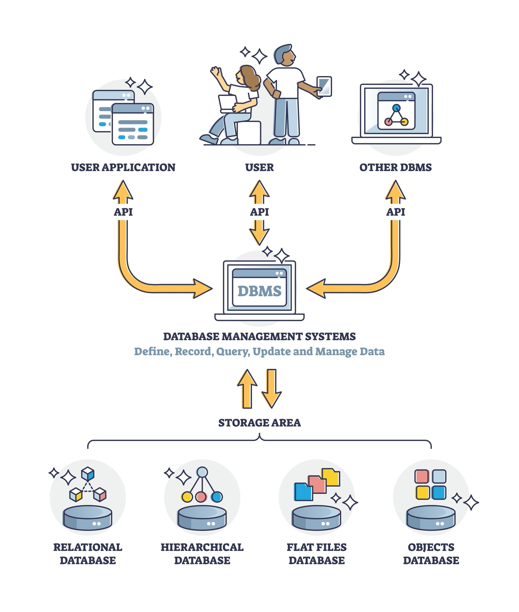

# DBChaos: 基于数据库内核原语构造的不利注入工具



## 1. 项目定位

**DBChaos** 是一款面向数据库系统的**不利注入工具**。  
它不是单纯从业务侧叠加压力，而是从数据库**内核子系统**出发，主动构造连接、优化、执行、事务、存储、日志等路径上的不利条件，用来探测数据库系统的**韧性边界**与**韧性能力**。

换句话说，DBChaos 关注的问题是：

- 数据库在异常压力或机制扰动下会在哪里失稳
- 数据库是否还能维持服务、退化运行或自动恢复
- 数据库不同内核子系统之间的隔离性、恢复性和抗压能力如何

---

## 2. 工具特点

- **内核子系统视角**：不利点围绕数据库连接、SQL 编译、执行、事务、存储、日志等核心路径组织。
- **机制级注入**：通过 SQL、事务、连接和资源占用等方式诱发数据库内部机制变化，而不是只从外部施压。
- **多语系适配**：当前实现面向 openGauss、PostgreSQL 及 MySQL 兼容语系。
- **适合压测联动**：可与 TPC-C 等基准测试联动，在业务负载运行期间注入不利并观察系统行为变化。

---

## 3. 当前已覆盖的内核子系统

DBChaos 当前按如下数据库内核子系统组织不利能力：

- 连接与会话管理
- SQL 编译与优化
- 执行引擎
- 事务与并发控制
- 存储引擎
- 缓冲管理
- 日志、检查点与崩溃恢复
- 后台维护与系统任务
- 资源治理与系统配额

其中，当前已经有落地不利 Case 的主要是前六类。

---

## 4. 当前已实现的不利 Case

### 连接与会话管理

- **连接风暴**：`max_connection / conn_storm`
- **连接耗尽**：`max_connection / conn_exhaustion`
- **会话执行线程池饱和**：`max_connection / thread_saturation`

### SQL 编译与优化

- **执行计划翻转**：`plan_flip`
- **深层表达式解析膨胀**：`stack_overflow / sql_depth`
- **视图展开深度膨胀**：`stack_overflow / view_nest`
- **Join 搜索空间爆炸**：`stack_overflow / join_bomb`

### 执行引擎

- **函数递归执行栈溢出**：`stack_overflow / func_recurse`
- **存储过程递归执行栈溢出**：`stack_overflow / proc_recurse`
- **事务路径递归执行栈溢出**：`stack_overflow / trans_recurse`
- **读取放大陷阱**：`read_amp_trap`

### 事务与并发控制

- **长事务持锁**：`uncommitted_txn`
- **热点更新冲突**：`duplicate_txn / UPDATE`
- **重复插入唯一性冲突**：`duplicate_txn / INSERT`
- **死锁检测风暴**：`deadlock_storm`
- **Prepared/XA 事务积压**：`max_prepared`

### 存储引擎

- **MVCC 膨胀注入**：`mvcc_bloat`

### 缓冲管理

- **大对象写入缓冲挤压**：`memory_pressure`

### 日志、检查点与崩溃恢复

- **高频事务回滚风暴**：`massive_rollback`

---

## 5. 系统结构

项目当前由三部分组成：

- **Core 层**：负责配置加载、数据库类型适配与 JDBC 连接基础能力
- **Inject 层**：每个不利 Case 对应一个具体注入实现
- **CLI / Script 层**：负责命令行入口、帮助信息以及与外部压测/配置脚本的联动

此外，项目已具备 **Case 模板、统一 JSON 注册表和脚手架脚本**，用于降低新增不利的开发成本。

---

## 6. 快速开始

### 环境依赖

- JDK 1.8+
- Maven 3.6+
- 目标数据库：openGauss、PostgreSQL 或 MySQL 兼容引擎

### 构建项目

Linux / macOS:

```bash
chmod +x build_for_linux.sh
./build_for_linux.sh DBChaos
```

Windows 本地环境:

```powershell
.\build_for_win.ps1 build
```

如果只想预览当前 CLI / Help 输出，可以执行：

```powershell
.\build_for_win.ps1 preview-help
```

### 查看当前支持的不利入口

```bash
java -jar DBChaos-0.0.1.jar --help
```

如果未显式传入 `--db`，默认读取 `resources/db.properties` 中的 `type`。

### 在注入前探测数据库连接

Windows 本地环境可以先执行：

```powershell
.\scripts\probe\check_db_connection.ps1
```

Linux / macOS 环境可以先执行：

```bash
./scripts/probe/check_db_connection.sh
```

如果需要临时覆盖数据库类型或连接参数，也可以追加参数：

```powershell
.\scripts\probe\check_db_connection.ps1 --db opengauss -url "jdbc:opengauss://host:port/database" -user demo -password demo
```

```bash
./scripts/probe/check_db_connection.sh --db opengauss -url "jdbc:opengauss://host:port/database" -user demo -password demo
```

### 执行一个不利注入

以 openGauss 上的执行计划翻转为例：

```bash
java -jar DBChaos-0.0.1.jar --db opengauss sql plan_flip -threads 16 -duration 300000 -interval 60000
```

---

## 7. 与压测联动

### 测试前稳定监控与基准值

业务负载单独启动后，可以用一条 DBChaos 命令完成“等待稳定 → 自动注入故障”，无需脚本在两个 Java 命令之间衔接：

```bash
java -jar DBChaos-0.0.1.jar --db opengauss txn deadlock_storm \
  -duration 30000 \
  --wait-stable /path/to/benchmark/results \
  --baseline-json /path/to/benchmark/results/baseline.json
```

该命令在同一 Java 进程内读取 BenchmarkSQL 的实时 `result.csv`，稳定后自动执行当前故障。
故障开始后会继续采集业务吞吐量，撤销后观察恢复，并在 `reportTest()` 中报告 P0、t0、td、tr、Pd、Pr、下降/恢复比例及隔离影响。
默认将 `throughput.csv`、`database-health.csv`、`resilience.json` 和 `report.txt` 保存到 `result.csv` 同级的 `dbchaos-reports/<本次运行>/`；
恢复最长观察 180 秒，默认连续稳定且达到基线 95% 时确认恢复。可通过 `--recovery-timeout`、`--recovery-ratio`、`--isolation-max-drop` 和 `--report-dir` 调整。
业务负载须持续运行到恢复观测结束；没有业务数据或证据不足时不生成肯定的韧性结论。详见[业务韧性指标与全程报告](docs/testing/韧性指标与报告.md)。
稳定条件和等待时间沿用下述监控默认值；超时退出码为 `3`，不执行故障。
监控出错退出码为 `1`，参数错误为 `2`。`--help` 直接显示帮助，不等待或注入。
未提供 `--wait-stable` 时，保留原来的立即注入行为。

可用 `--baseline-` 前缀覆盖监控参数：`window`、`stable-windows`、`tps-cv`、`p95-swing`、
`min-wait`、`max-wait`、`poll`、`ignore-first`、`exclude-ttype`、`json`，例如
`--baseline-min-wait 60 --baseline-max-wait 240`。这些选项与故障参数分开解析，不传入注入器。
自动注入始终采用超时失败策略，不支持 `--baseline-on-timeout continue`。
业务负载仍需由 BenchmarkSQL 或外部业务程序运行，监控的数据格式为 BenchmarkSQL `result.csv`。

如果只需要等待稳定并输出基准值，也可以单独运行监控命令：

压测启动后、故障注入前，先等待数据库服务性能稳定，再把稳定窗口的 TPC-C 成功 TPS 与
p95 延迟作为本轮测试基准：

```bash
java -jar DBChaos-0.0.1.jar monitor baseline \
  -result-dir /path/to/benchmark/results \
  -json /path/to/benchmark/results/baseline.json
```

该命令实时读取 BenchmarkSQL 的 `result.csv`，默认每 10 秒一个窗口，最近 3 个完整窗口同时满足
`TPS 变异系数 <= 5%` 且 `p95 波动 <= 10%` 时判定为稳定。所有参数均可配置：
`-window`、`-stable-windows`、`-tps-cv`、`-p95-swing`、`-min-wait`、`-max-wait`、
`-poll`、`-ignore-first`、`-exclude-ttype`、`-on-timeout <fail|continue>`。

- 退出码 `0`：已稳定（或 `-on-timeout continue` 下带警告继续）；`3`：超时仍未稳定且要求失败。
- 若 `result.csv` 在最长等待内停止增长，空窗口会参与判定，服务停摆不会被误判为稳定。
- `-json` 输出包含 `successful_tps`、`p95_ms` 以及各窗口明细，供后续报告直接引用。

如果需要在 TPC-C 或其他基准测试运行期间注入不利，还可以结合 `scripts/` 下的配置生成脚本使用。
相关说明见：

- [scripts/README.md](./scripts/README.md)

## 8. 如何新增一个不利

当前项目已经具备模板化、注册化、自动联动的扩展能力。  
新增一个不利时，不再需要手工同步修改多处代码，而是按统一流程完成：

1. 使用 `scripts/scaffold/` 下的脚手架生成新的注入器类
2. 自动补齐 `resources/registry/registry.json` 中的 Case 注册信息
3. 如有需要，再追加配置生成注册信息

脚手架说明见：

- [scripts/scaffold/README.md](./scripts/scaffold/README.md)

---

## 9. 开发者

- **Author**: 西北工业大学
- **Project**: DBChaos
